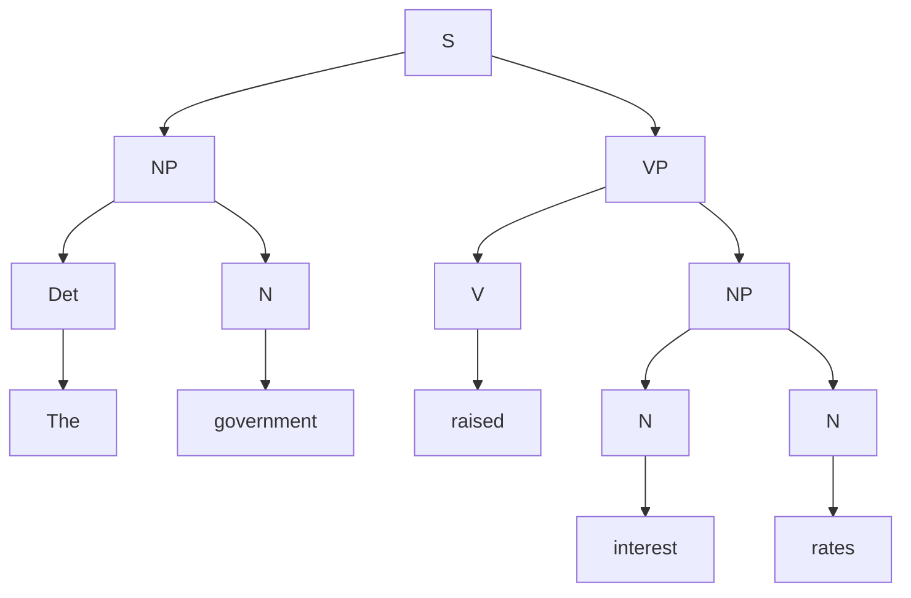

# Unit 8 - Creating Parse Trees

## Task
Create a constituency-based parse tree for the following phrases:
1. The government raised interest rates.
2. The internet gives everyone a voice.
3. The man saw the dog with the telescope.

## Solutions

### Solution 1 - The government raised interest rates

